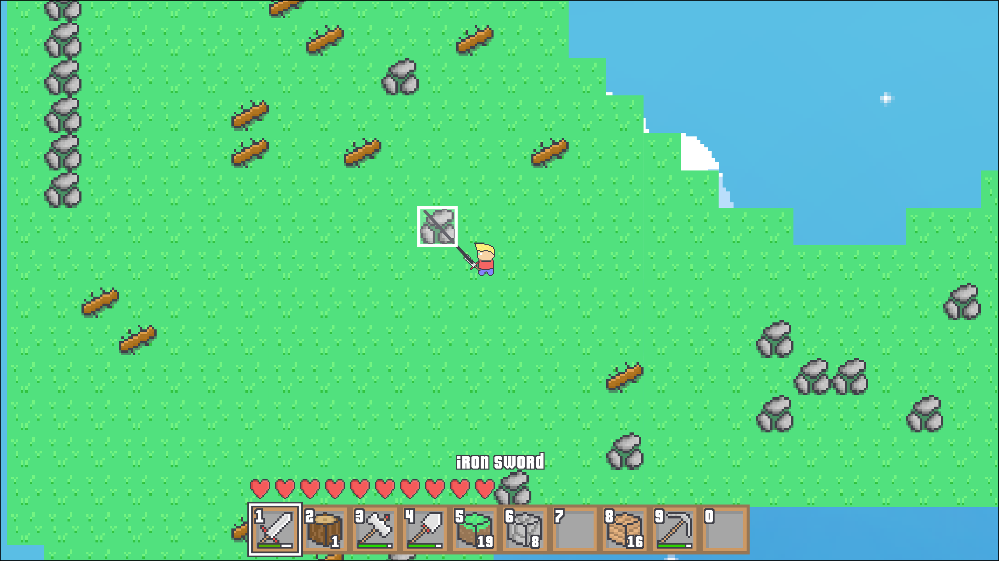
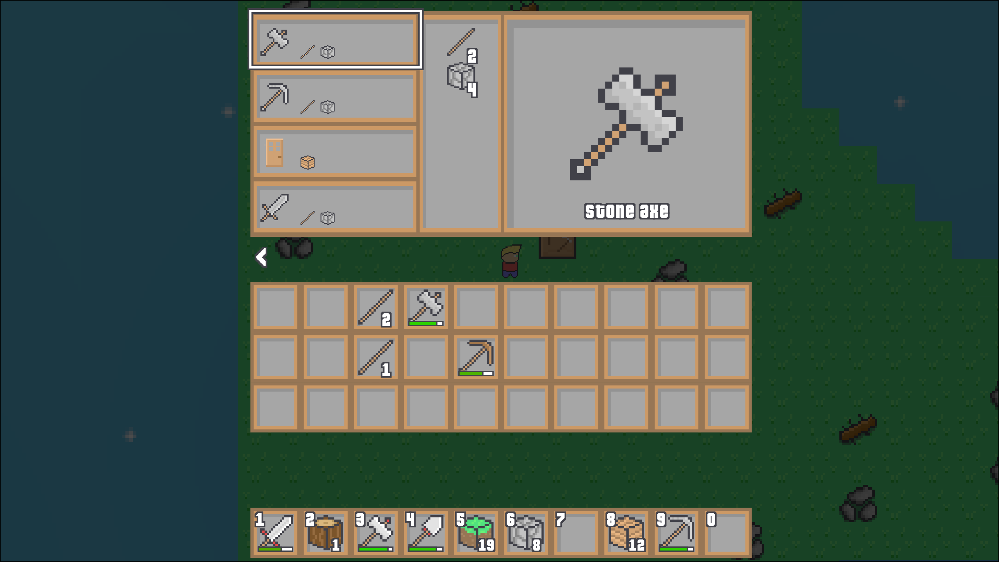

# Floating Island

Floating Island, a multiplayer browser-game with randomly generated worlds. Created as my Matura Thesis.

This repo contains both the back-end server and the front-end game. A public server instance exists, and can be accessed at https://floatingisland.ch.

Features:
- Persistent, modifiable worlds
- Multiplayer with friends
- Account system, Friend system

## Images





## Running a server

A server can be started by running:

```node server```

This will create a public server on the port 80.

Additionally, a local server can be started using:

```node server --local```

This server will be accessible at the address http://localhost:16762
